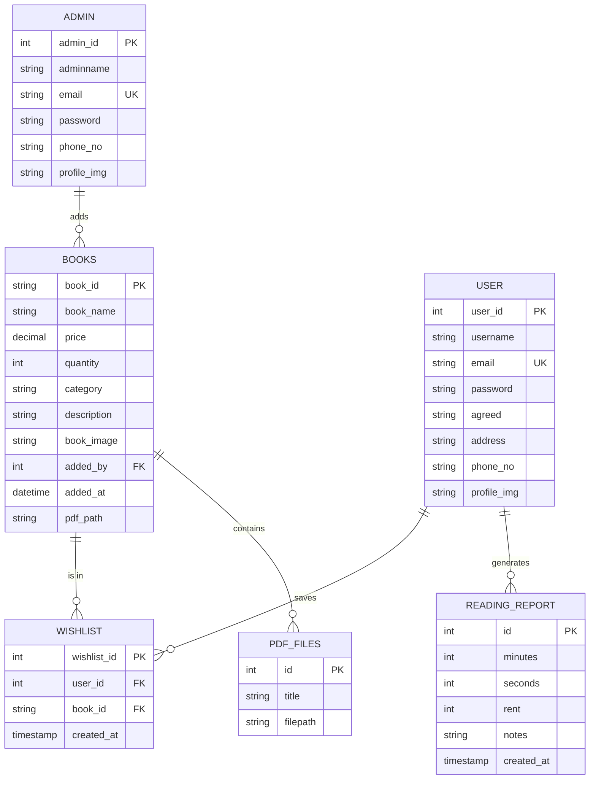

# 📚 E-Library Management System

A full-stack, cloud-ready digital library and book marketplace application built with **Python**, **Flask**, and **SQLite/MySQL**. The platform enables users to discover, read, rent, and purchase books with an integrated reader timer, email OTP authentication, and Razorpay checkout.

---

## 🌟 Key Features

### 👤 User Capabilities
- **Secure Registration & Login**: Email verification via OTP (SMTP) and password hashing with `bcrypt`.
- **Password Recovery**: Secure tokenized password reset links sent via email.
- **Book Discovery**: Filter books by category (`Frontend`, `Backend`, `Stories`, `Kids`, `Geography`), keyword search, and popularity.
- **In-Browser PDF Reader**:
  - Embedded PDF reader with page navigation.
  - Interactive **Reading Timer** tracking active minutes and calculating rental cost.
  - Notes taking and automated summary PDF generation.
- **E-Commerce & Payment**:
  - Cart management and Single-Item "Buy Now".
  - Seamless Razorpay payment gateway integration.
- **Wishlist**: Toggle books in and out of personal wishlist.
- **User Profile**: Edit username, address, contact details, and upload custom profile pictures.

### 🛡️ Admin Capabilities
- **Dedicated Admin Portal**: Separate authentication flow and dashboard with live metrics (total books, categories).
- **Book Catalog Management**: Upload books with title, price, quantity, category, description, cover image, and PDF attachment.
- **Automated Text Extraction**: Reads and parses uploaded PDF files with `PyPDF2`.
- **Publisher Overview**: View, inspect, and manage books uploaded by administrators.
- **Profile Updates**: Manage admin avatar and contact info.

---

## 🏗️ Architecture & Database Schema

The database supports both **SQLite** (embedded, zero-configuration local development) and **MySQL** (cloud production/RDS).



---

## 📁 Project Structure

```
library/
│
├── .env.example               # Template for environment variables
├── .gitignore                 # Files and folders to ignore in Git
├── Procfile                   # Process file for cloud platforms (Render, Railway, Heroku)
├── README.md                  # Project documentation
├── requirements.txt           # Python package dependencies
│
└── library/
    ├── app.py                 # Core application routes and backend logic
    ├── cmail.py               # Email delivery service (SMTP SSL)
    ├── config.py              # Application secret tokens
    ├── keys.py                # Payment gateway API credentials
    ├── otp.py                 # Cryptographic OTP generator
    ├── stoken.py              # Timed URL serializer for secure tokens
    │
    ├── static/
    │   ├── images/            # Application UI assets and avatars
    │   └── uploads/           # Uploaded book covers and PDF documents
    │
    └── templates/             # Jinja2 HTML templates
        ├── welcome.html       # Landing page
        ├── index.html         # Portal choice
        ├── user_register.html # User signup
        ├── user_login.html    # User login
        ├── adminlogin.html    # Admin login
        ├── adminregister.html # Admin signup
        ├── adminpanel.html    # Admin management dashboard
        ├── reader.html        # Interactive PDF reader with timer
        ├── cart.html          # Shopping cart
        ├── payment.html       # Razorpay checkout
        └── ...                # Other feature templates
```

---

## 🚀 Quick Start Guide

### 1. Prerequisites
- **Python 3.10+**
- **Git**

### 2. Clone the Repository
```bash
git clone <your-repository-url>
cd library
```

### 3. Create a Virtual Environment
```bash
# Windows
python -m venv venv
venv\Scripts\activate

# macOS / Linux
python3 -m venv venv
source venv/bin/activate
```

### 4. Install Dependencies
```bash
pip install -r requirements.txt
```

### 5. Configure Environment Variables
Copy the `.env.example` file to `.env`:
```bash
cp .env.example .env
```
Configure your settings:
```ini
# Flask
SECRET_KEY=super_secret_key_change_in_production
FLASK_DEBUG=True
PORT=5000

# Database (Default: 'sqlite' requires zero setup)
DB_TYPE=sqlite
DB_NAME=librarydb

# Email Service
MAIL_USERNAME=your_email@gmail.com
MAIL_PASSWORD=your_16_character_gmail_app_password

# Razorpay (Optional - test keys provided)
RAZORPAY_KEY_ID=rzp_test_RhD85xqgyfh89M
RAZORPAY_KEY_SECRET=5f5C7wbx2A8Ms58ew8uNDTMl
```

### 6. Run the Application
```bash
python library/app.py
```
Open your browser at: `http://localhost:5000`

---

## 🔑 Default Test Credentials

The database auto-seeds a default admin account upon first startup:
- **Admin Portal**: `http://localhost:5000/adminlogin`
- **Email**: `admin@gmail.com`
- **Password**: `admin123`

---

## ☁️ Cloud Deployment

This repository is pre-configured with:
1. **`Procfile`**: Automatically triggers `gunicorn --chdir library app:app`.
2. **Dynamic Host & Port Binding**: Binds to `0.0.0.0` and listens on `PORT` defined by the host environment.
3. **Database Flexibility**: Works on **Render**, **Railway**, **AWS Elastic Beanstalk**, or **Docker** without code modifications.

---

## 📄 License
This project is open-source under the [MIT License](LICENSE).
